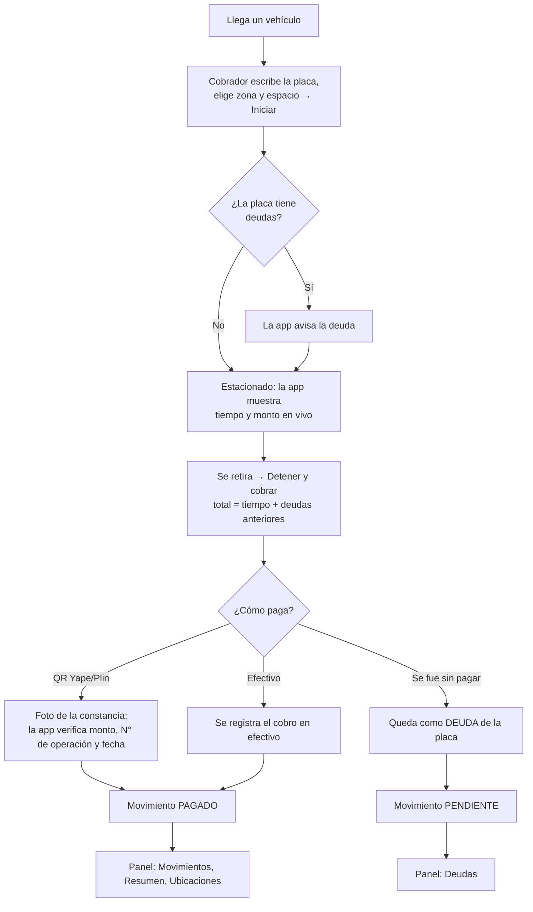
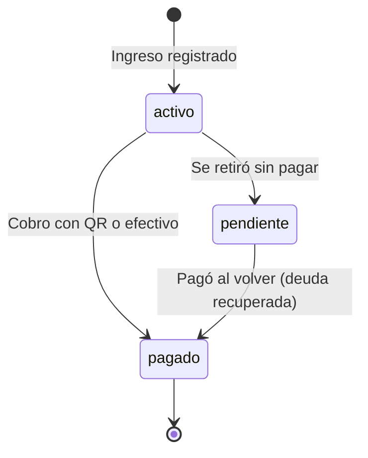
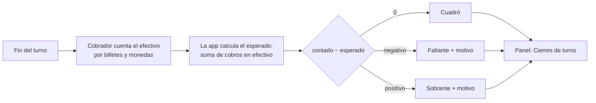
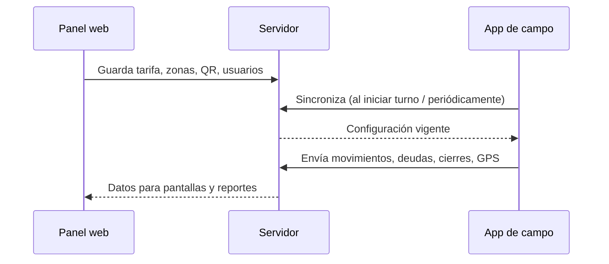
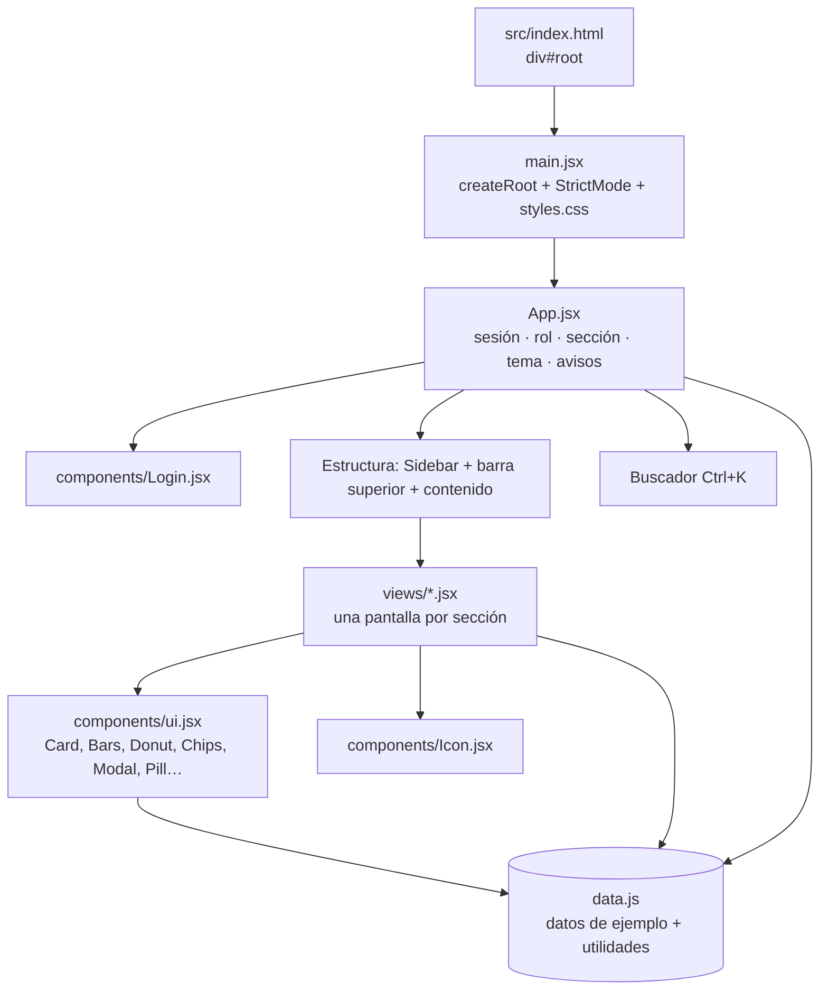
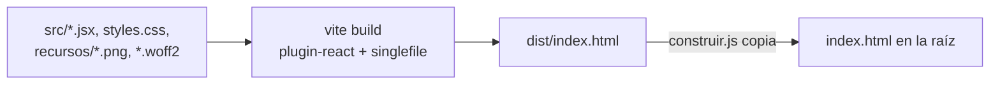

# SICOE · Panel web administrativo — Documentación

**Sistema de Cobro de Estacionamiento**
Municipalidad de San Juan de Lurigancho · Subgerencia de Transporte

> SICOE tiene dos partes, cada una en su propio repositorio:
>
> - **App de campo** (cobradores, celular Android): https://github.com/Angela08T/APP-SICOE
> - **Panel web** (oficina, navegador): https://github.com/Angela08T/WEB-PARQUEO ← *este repositorio*

---

## Contenido

1. [Resumen del proyecto](#1-resumen-del-proyecto)
2. [Contexto: el sistema SICOE completo](#2-contexto-el-sistema-sicoe-completo)
3. [Procesos y flujos de negocio](#3-procesos-y-flujos-de-negocio)
4. [Reglas del cobro y del control](#4-reglas-del-cobro-y-del-control)
5. [Tecnologías](#5-tecnologías)
6. [Arquitectura del panel](#6-arquitectura-del-panel)
7. [Modelo de datos](#7-modelo-de-datos)
8. [Pantallas en detalle](#8-pantallas-en-detalle)
9. [Instalación, ejecución y publicación](#9-instalación-ejecución-y-publicación)
10. [Manual de usuario](#10-manual-de-usuario)
11. [Guía para desarrolladores](#11-guía-para-desarrolladores)
12. [Diseño visual, accesibilidad y adaptación a pantallas](#12-diseño-visual-accesibilidad-y-adaptación-a-pantallas)
13. [Conexión futura con el servidor (propuesta)](#13-conexión-futura-con-el-servidor-propuesta)
14. [Seguridad y limitaciones conocidas](#14-seguridad-y-limitaciones-conocidas)
15. [Problemas comunes y soluciones](#15-problemas-comunes-y-soluciones)
16. [Estado actual y próximos pasos](#16-estado-actual-y-próximos-pasos)
17. [Glosario](#17-glosario)

---

## 1. Resumen del proyecto

| | |
|---|---|
| **Qué es** | Página web para el personal administrativo y de soporte que controla el cobro de estacionamiento en la vía pública. |
| **Quién lo usa** | Administradores del sistema (equipo de desarrollo y soporte) y personal administrativo de la Subgerencia de Transporte. |
| **Qué permite** | Ver la recaudación del día, la ocupación de cada zona, los movimientos, las deudas, los cierres de caja y las ubicaciones de los cobradores. También gestionar usuarios, zonas y la tarifa, y descargar reportes. |
| **Estado** | **Boceto funcional** (prototipo navegable). Todas las pantallas existen y responden, pero usan **datos de ejemplo** generados en el navegador y todavía no se conectan a ningún servidor. |
| **Cómo se entrega** | Un único archivo `index.html` (~600 KB) con código, estilos, logo y tipografías incluidos. Se abre con doble clic y funciona sin internet. |

---

## 2. Contexto: el sistema SICOE completo

```
        CALLE                                                     OFICINA
┌──────────────────────────┐      ┌──────────────────────┐      ┌──────────────────────────────┐
│ App de campo (APP-SICOE) │      │ Servidor + base de   │      │ Panel web (este repositorio) │
│ Celular Android          │      │ datos  (PENDIENTE)   │      │ Navegador                    │
│                          │      │                      │      │                              │
│ • Registrar placa        │ ───▶ │ • Movimientos        │ ───▶ │ • Resumen, ocupación en vivo │
│ • Tiempo y monto en vivo │      │ • Deudas             │      │ • Movimientos, deudas        │
│ • Cobro QR / efectivo    │      │ • Cierres de turno   │      │ • Cierres, ubicaciones       │
│ • Verificar constancia   │      │ • Usuarios y permisos│      │ • Usuarios, zonas y tarifa   │
│ • Deudas por placa       │ ◀─── │ • Tarifa, zonas, QR  │ ◀─── │ • Reportes, actividad        │
│ • Cierre de turno        │      │                      │      │                              │
└──────────────────────────┘      └──────────────────────┘      └──────────────────────────────┘
   Datos en el celular              Fuente única de verdad          Hoy: datos de ejemplo
```

- La **app de campo** registra lo que pasa en la calle.
- El **servidor** (todavía no existe) recibirá esos registros y guardará la configuración.
- El **panel web** muestra la información y envía la configuración (tarifa, zonas, QR y usuarios) a las apps.

---

## 3. Procesos y flujos de negocio

### 3.1 Recorrido de un vehículo



Cada movimiento guarda la **hora de entrada**, la **hora de salida**, el **monto**, el **medio de pago**, el **N° de
operación** (si es QR), el **cobrador** y la **ubicación GPS** del celular al registrar el ingreso y el cobro.

### 3.2 Ciclo de vida de un movimiento



| Estado | Significado | Etiqueta en el panel |
|---|---|---|
| `activo` | El vehículo sigue estacionado | azul «En parqueo» |
| `pagado` | Se cobró (`metodo` = `QR` o `Efectivo`) | verde «Pagado · QR/Efectivo» |
| `pendiente` | Se fue sin pagar: es una deuda | rojo «No pagó» |

### 3.3 Deudas

1. El vehículo se retira sin pagar y el monto queda como deuda de la **placa**.
2. Cuando esa placa se vuelve a registrar en cualquier zona, la app avisa al cobrador.
3. Al cobrar, el total incluye las deudas anteriores. Al pagar, todas quedan pagadas y se marcan como **recuperadas**.
   El panel distingue si se cobró **«Junto al estacionamiento»** (con el nuevo ingreso) o **«Solo la deuda»**.

### 3.4 Cierre de turno (cuadre de caja)



Los pagos con QR no entran en el cuadre porque el dinero va directo a la cuenta municipal. Se muestran solo como
referencia.

### 3.5 Verificación de constancias (pagos con QR)

El cobrador fotografía la constancia de Yape o Plin y la app compara monto, N° de operación y fecha. El panel muestra
el resultado en la columna **Constancia** de *Movimientos*:

| Resultado | Cuándo |
|---|---|
| **Verificada** | La constancia coincide |
| **Revisar** | La app no pudo leerla con seguridad |
| **Alerta** | Ejemplos: *constancia ya usada en otra placa*, *monto distinto al total*, *constancia de otro día* |
| **Sin verificar** | No se tomó foto |

### 3.6 Control de ubicación (GPS)

Cada ingreso y cada cobro guardan dónde estaba el celular. Si el registro se hizo a **más de 120 m** del tramo de
calle de su zona, se marca **«fuera de zona»**. Esto aparece en *Ubicaciones*, en la columna GPS de *Movimientos* y
en el *Control del día* del Resumen.

### 3.7 Configuración del panel a las apps (futuro)



---

## 4. Reglas del cobro y del control

### 4.1 Tarifa vigente

| Parámetro | Valor |
|---|---|
| Monto por fracción | **S/ 0.80** |
| Duración de la fracción | **30 minutos** |
| Tolerancia | **0 minutos** (configurable) |

Toda fracción empezada se cobra completa y siempre se cobra al menos una.

Fórmula que usa el panel en *Zonas y tarifa* (`src/views/Zonas.jsx`):

```
si minutos ≤ tolerancia  →  S/ 0.00
si no                    →  máximo(1, redondear hacia arriba(minutos ÷ fracción)) × monto
```

| Tiempo | Fracciones | Monto |
|---|:-:|---|
| 10 min | 1 | S/ 0.80 |
| 30 min | 1 | S/ 0.80 |
| 1 h | 2 | S/ 1.60 |
| 1 h 10 min | 3 | S/ 2.40 |
| 2 h 30 min | 5 | S/ 4.00 |

> ⚠️ **Por confirmar con la app de campo:** en el panel, la tolerancia funciona como un periodo gratuito y, cuando
> se supera, se cobra el tiempo completo. Otra forma posible es descontar la tolerancia antes de calcular
> (`(minutos − tolerancia) ÷ fracción`). Con tolerancia 0 ambas dan el mismo resultado. Antes de cambiar la tolerancia
> hay que asegurarse de que el panel y la app usen la misma fórmula.

### 4.2 Zonas

| id | Zona | Espacios | Cobrador asignado (ejemplo) |
|:-:|---|:-:|---|
| 0 | AV. FERNANDO WIESSE 32 IMPAR | 10 | Luis Quispe Ramos |
| 1 | AV. FERNANDO WIESSE 32 PAR | 10 | Luis Quispe Ramos |
| 2 | AV. FERNANDO WIESSE 33 IMPAR | 22 | María Huamán Torres |
| 3 | AV. FERNANDO WIESSE 33 PAR | 22 | María Huamán Torres |
| 4 | CL. VARA DE ORO 2 IMPAR | 16 | Jorge Paredes Vílchez |
| 5 | CL. VARA DE ORO 2 PAR | 16 | Jorge Paredes Vílchez |
| 6 | JR. ALAMEDA LANZON 2 IMPAR | 16 | Rosa Salazar Ccori |
| 7 | JR. ALAMEDA LANZON 2 PAR | 16 | Rosa Salazar Ccori |
| 8 | JR. LAS MAQUINARIAS TRAMO 01 | 28 | Carlos Mamani Flores |
| 9 | JR. LAS MAQUINARIAS TRAMO 02 | 28 | Carlos Mamani Flores |
| 10 | JR. WIRACOCHA 2 IMPAR | 7 | Ana Gutiérrez Poma |
| 11 | JR. WIRACOCHA 2 PAR | 19 | Ana Gutiérrez Poma |
| | **Total** | **210** | |

Cada cobrador tiene dos zonas: la acera IMPAR y la PAR del mismo tramo. En los datos de ejemplo el cobrador de una
zona se obtiene con `COBR[Math.floor(zona / 2)]`.

### 4.3 Umbrales que usa el panel

| Regla | Valor | Dónde está |
|---|---|---|
| Zona «muy ocupada» (amarillo) | ≥ 80 % de ocupación | `Resumen.jsx`, `Vivo.jsx` |
| Espacio «más de 2 horas» | > 120 min estacionado | `Vivo.jsx` |
| Registro «fuera de zona» | > 120 m del tramo | `FUERA` en `data.js` |
| Caja «cuadró» | \|diferencia\| < S/ 0.005 | `Cierres.jsx` |
| Versión actual de la app | `1.4.2` | `Usuarios.jsx` (`ULTIMA`), `Actividad.jsx` |
| DNI válido | exactamente 8 dígitos | `Login.jsx`, `Usuarios.jsx` |

---

## 5. Tecnologías

| Tecnología | Versión | Para qué se usa |
|---|---|---|
| **React** | 19.3 | Interfaz por componentes (`src/App.jsx`, `src/views/`, `src/components/`) |
| **React DOM** | 19.3 | Dibujar la aplicación en el navegador (`createRoot`) |
| **Motion** (`motion/react`) | 14.2 | Animaciones: entradas, transiciones entre secciones, indicadores que se deslizan (`layoutId`), contadores, gráficos que se dibujan |
| **Vite** | 8.3 | Servidor de desarrollo con recarga inmediata y empaquetado |
| **@vitejs/plugin-react** | 6.1 | Soporte de JSX y recarga rápida de React en Vite |
| **vite-plugin-singlefile** | 2.3 | Junta JS, CSS, logo y fuentes en **un solo** `index.html` |
| **Node.js** | ≥ 20 | Solo para desarrollar y generar el archivo final (no hace falta para usar el panel) |
| **CSS propio** | — | Estilos con variables (tema claro y oscuro), sin frameworks de CSS |
| **SVG propio** | — | Íconos (estilo Lucide), gráficos de barras, dona, minigráficos y plano de zonas, todos dibujados a mano y sin librerías de gráficos ni mapas |
| **Tipografías** | — | *Plus Jakarta Sans* (texto) y *Fredoka* (títulos), incluidas como `.woff2` |

Por qué se eligió así:

- **No necesita servidor ni internet.** Con el archivo único se puede abrir en cualquier computadora de la
  municipalidad, enviar por correo o copiar en una memoria USB.
- **Pocas dependencias.** Solo React y Motion en tiempo de ejecución. Los gráficos y el mapa son SVG propios, así que
  no dependen de servicios externos como Google Maps ni de librerías pesadas.
- **Fácil de conectar después.** Todas las pantallas leen sus datos de un único módulo (`src/data.js`).

---

## 6. Arquitectura del panel

### 6.1 Vista general



Capas:

| Capa | Archivos | Responsabilidad |
|---|---|---|
| Entrada | `src/index.html`, `src/main.jsx` | Página base y arranque de React |
| Aplicación | `src/App.jsx` | Inicio de sesión, perfil, navegación, permisos, tema, búsqueda, notificaciones, avisos |
| Pantallas | `src/views/*.jsx` | Cada sección del menú: calcula sus indicadores y dibuja tablas y gráficos |
| Componentes | `src/components/ui.jsx`, `Icon.jsx`, `Login.jsx` | Piezas reutilizables, íconos y pantalla de ingreso |
| Datos | `src/data.js` | Datos de ejemplo, constantes del negocio y funciones de formato. **Es la única fuente de datos.** |
| Estilos | `src/styles.css`, `src/recursos/` | Colores, componentes, adaptación a pantallas, tipografías y logo |
| Construcción | `vite.config.mjs`, `construir.js` | Desarrollo y generación de `index.html` |

### 6.2 Navegación (rutas por `#`)

No hay librería de rutas. La sección activa se guarda en la dirección (`location.hash`):

| Dirección | Sección | Componente |
|---|---|---|
| `#resumen` | Resumen del día | `Resumen.jsx` |
| `#vivo` | Ocupación en vivo | `Vivo.jsx` |
| `#movimientos` | Movimientos | `Movimientos.jsx` |
| `#deudas` | Deudas | `Deudas.jsx` |
| `#cierres` | Cierres de turno | `Cierres.jsx` |
| `#mapa` | Ubicaciones | `Mapa.jsx` |
| `#usuarios` | Usuarios | `Usuarios.jsx` |
| `#cobradores` | Cobradores | `Cobradores.jsx` |
| `#zonas` | Zonas y tarifa | `Zonas.jsx` |
| `#reportes` | Reportes *(solo admin)* | `Reportes.jsx` |
| `#actividad` | Actividad *(solo admin)* | `Actividad.jsx` |

- `VIEWS` (en `App.jsx`) asocia cada clave con su título, subtítulo y componente.
- Al cambiar el `#` (evento `hashchange`), se actualiza la sección, se cierra el menú del celular y se vuelve arriba.
- Si el `#` no existe, se muestra `#resumen`.

### 6.3 Perfiles y permisos

```js
// App.jsx
const NAV = {
  admin: [OPERACION, CONTROL, ['Administración', [...ADMINISTRACION, reportes]], ['Sistema', [actividad]]],
  staff: [OPERACION, CONTROL, ['Administración', ADMINISTRACION]]
};
const permitido = (rol, v) => NAV[rol].some(([, items]) => items.some(([k]) => k === v));
```

- El **menú es la lista de permisos**: un perfil solo puede abrir las secciones que aparecen en su menú.
- Si se intenta abrir una sección sin permiso (por ejemplo, `#reportes` como personal administrativo), aparece el aviso
  *«Tu perfil no tiene acceso a esa sección»* y se vuelve al Resumen.
- En *Usuarios*, el personal administrativo **no puede** asignar el perfil de administrador ni modificar o desactivar
  cuentas de administrador. Nadie puede desactivar su propia cuenta.
- El perfil elegido se guarda en `sessionStorage` (`sicoe-rol`) mientras la pestaña esté abierta.

> Estos controles son **solo de pantalla**. Ver [Seguridad](#14-seguridad-y-limitaciones-conocidas).

### 6.4 Estado y comunicación entre componentes

| Estado | Dónde vive | Detalle |
|---|---|---|
| Sesión iniciada, perfil, sección | `App` (`useState`) | `logged`, `rol`, `view` |
| Avisos inferiores | `App` → contexto `UI` | `toast(mensaje)` dura 2,6 s |
| Perfil para las pantallas | contexto `UI` | `const { toast, rol } = useUI()` |
| Tema claro/oscuro | `useTema()` + `localStorage` (`sicoe-tema`) | Sin elección, sigue al sistema operativo |
| Filtros, pestañas y páginas | Cada pantalla (`useState`) | Se pierden al cambiar de sección |
| Ediciones (usuarios, deudas cobradas) | Copia local en la pantalla | **No se guardan** al recargar |

No hay un almacén global como Redux: los datos se importan directamente de `data.js` y cada pantalla calcula lo que
necesita (con `useMemo` cuando el cálculo es costoso).

### 6.5 Simulación de «tiempo real»

Mientras no exista el servidor, hay dos simulaciones:

- **Resumen → Últimos movimientos:** cada 5,5 s llega un movimiento nuevo (`nuevoMovimiento()` de `data.js`).
- **Ocupación en vivo:** cada 3,5 s un vehículo entra o sale de un espacio al azar, que se resalta con un anillo.

La hora «actual» del boceto está fija en **hoy a las 17:20** (`AHORA` en `data.js`) para que siempre se vea un día
con movimiento.

### 6.6 Generación del archivo final



- `vite.config.mjs`: la raíz es `src/` y `assetsInlineLimit` es muy alto, así que el logo y las fuentes se incrustan
  en base64.
- `construir.js`: instala dependencias si falta `node_modules`, ejecuta `vite build` y copia `dist/index.html` a la
  raíz. Al terminar muestra el tamaño.
- `dist/` y `node_modules/` están en `.gitignore`. **`index.html` sí se versiona** para que se pueda usar sin
  instalar nada.

### 6.7 Estructura del repositorio

```
WEB-PARQUEO/
├── index.html              Panel ya generado (abrir con doble clic). NO editar a mano.
├── package.json            Dependencias y comandos (dev, build)
├── package-lock.json       Versiones exactas instaladas
├── construir.js            Genera index.html (npm run build)
├── vite.config.mjs         Configuración de Vite
├── .gitignore              node_modules/, dist/, .env
├── README.md               Presentación corta
├── docs/
│   └── DOCUMENTACION.md    Este documento
├── version-html/
│   └── panel.html          Versión anterior del panel en HTML/JS sin React (solo referencia)
└── src/
    ├── index.html          Página base para Vite (div#root)
    ├── main.jsx            Punto de entrada
    ├── App.jsx             Estructura, menú, permisos (NAV), búsqueda, notificaciones, tema
    ├── data.js             Datos de ejemplo, constantes y utilidades de formato
    ├── styles.css          Todos los estilos (claro/oscuro, adaptación a pantallas)
    ├── recursos/           logo-sjl.png, fredoka-700.woff2, jakarta-800.woff2
    ├── components/
    │   ├── Icon.jsx        Íconos SVG incluidos en el código
    │   ├── Login.jsx       Pantalla de inicio de sesión
    │   └── ui.jsx          Card, CardHead, CountUp, Spark, Donut, Bars, Chips, Modal, Who, Plate, Pill, PillEstado, Fill
    └── views/
        ├── Resumen.jsx     ├── Vivo.jsx        ├── Movimientos.jsx  ├── Deudas.jsx
        ├── Cierres.jsx     ├── Mapa.jsx        ├── Usuarios.jsx     ├── Cobradores.jsx
        ├── Zonas.jsx       ├── Reportes.jsx    └── Actividad.jsx
```

---

## 7. Modelo de datos

Todo está en `src/data.js`. Los datos se generan con un generador pseudoaleatorio de **semilla fija**
(`seed = 20261014`, y `seed2 = 7731` para los datos de control), así que el panel muestra siempre los mismos datos.

Cuando exista el servidor, este modelo sirve de base para las tablas de la base de datos (ver la
[sección 13](#13-conexión-futura-con-el-servidor-propuesta)).

### 7.1 Zona (`ZONAS`)

| Campo | Tipo | Descripción |
|---|---|---|
| `id` | número 0–11 | Identificador |
| `n` | texto | Nombre (p. ej. `JR. WIRACOCHA 2 PAR`) |
| `cap` | número | Cantidad de espacios |
| `seg` | `[[x,y],[x,y]]` | Tramo de calle en el plano, en metros (solo para dibujar *Ubicaciones*) |

`CAP` es la suma de espacios (210). `CALLES` define las calles del plano.

### 7.2 Usuario de campo / cobrador (`COBR`)

| Campo | Tipo | Descripción |
|---|---|---|
| `nombre`, `dni` | texto | Identificación (DNI de 8 dígitos) |
| `zonas` | número[] | Zonas asignadas (ids) |
| `activo` | sí/no | Si puede ingresar a la app |
| `tipo` | `'campo'` | Siempre «campo» |
| `cel`, `ver`, `sync` | texto | Modelo del celular, versión de la app, última sincronización |
| `col`, `tx` | color | Colores del avatar |

### 7.3 Usuario del panel (`ADMINS`)

| Campo | Tipo | Descripción |
|---|---|---|
| `nombre`, `dni` | texto | Identificación |
| `rol` | `'admin'` \| `'staff'` | Perfil (ver `ROLES`) |
| `cargo` | texto | Área o cargo |
| `ultimo` | texto | Último ingreso |
| `activo` | sí/no | Si puede ingresar |
| `tipo` | `'web'` | Siempre «web» |

`SESION_DEMO` define qué usuario aparece con la sesión iniciada según el perfil: admin → *Marco Silva Rojas*,
staff → *Rosa Mendoza Quispe*.

### 7.4 Movimiento (`T`)

Los movimientos de los últimos 7 días más los vehículos estacionados ahora, del más reciente al más antiguo.

| Campo | Tipo | Descripción |
|---|---|---|
| `id` | texto | `m0`, `m1`… (los simulados en vivo usan `n0`, `n1`…) |
| `placa` | texto | Formato `ABC-123` |
| `zona`, `espacio` | número | Zona (id) y N° de espacio |
| `inicio`, `fin` | fecha | Entrada y salida (`fin = null` si sigue estacionado) |
| `monto` | número | En soles |
| `estado` | `'activo'` \| `'pagado'` \| `'pendiente'` | Ver [3.2](#32-ciclo-de-vida-de-un-movimiento) |
| `metodo` | `'QR'` \| `'Efectivo'` \| `null` | Solo si está pagado |
| `op` | texto | N° de operación del pago con QR (puede estar vacío) |
| `verif` | `{estado:'ok'\|'revisar'\|'alerta', motivo?}` \| `null` | Verificación de la constancia (solo QR) |
| `gps`, `gpsCobro` | Punto GPS | Ubicación del ingreso y del cobro |
| `cobrador` | Cobrador | Quién lo registró |
| `modelo`, `color` | texto | Vehículo |

**Punto GPS:** `{ x, y, prec, dist, fuera }`. `x` e `y` son metros en el plano, `prec` es la precisión en metros,
`dist` es la distancia al tramo de su zona y `fuera` vale `dist > 120`. `latlng(p)` lo convierte a latitud y
longitud de ejemplo.

### 7.5 Deuda recuperada (`RECUPERADAS`)

Igual que un movimiento, con `estado:'pagado'`, `recuperada:true` y además:

| Campo | Descripción |
|---|---|
| `pagadoEn` | Cuándo pagó la deuda |
| `junto` | `true` si se cobró junto con un nuevo estacionamiento |

### 7.6 Turno / cierre de caja (`TURNOS`)

| Campo | Descripción |
|---|---|
| `id` | `t{día}-{cobrador}` |
| `cobrador` | Cobrador |
| `desde`, `hasta` | Inicio y fin del turno (`hasta = null` si está en curso) |
| `cobros` | Cantidad de pagos del turno |
| `qr` | Total cobrado por QR |
| `efectivo` | Efectivo que debía entregar (suma de cobros en efectivo) |
| `contado` | Efectivo contado al cerrar (`null` si está en curso) |
| `diferencia` | `contado − efectivo` (negativo = faltó, positivo = sobró) |
| `deudas` | Vehículos que se fueron sin pagar en el turno |
| `nota` | Motivo que escribió el cobrador si no cuadró |

### 7.7 Actividad (`ACTIVIDAD`)

Lista de `[origen, ícono, texto, detalle, hora]`. El origen es `'web'` (panel) o `'app'` (app de campo) y el ícono es
`login`, `sync`, `alert`, `edit`, `download` o `coins`.

### 7.8 Funciones de utilidad (`data.js`)

| Función | Qué hace |
|---|---|
| `money(n)` | `S/ 1.60` |
| `pad(n)` | Dos dígitos (`07`) |
| `hhmm(fecha)` | `17:20` |
| `sum(lista)` | Suma de `monto` |
| `ini(nombre)` | Iniciales para el avatar |
| `esHoy(fecha)` | Si la fecha es el día de `AHORA` |
| `distZona(p, z)` | Distancia de un punto al tramo de una zona |
| `latlng(p)` | Metros del plano → latitud y longitud de ejemplo |
| `nuevoMovimiento(min)` | Movimiento simulado para el «en vivo» |
| `rnd()`, `pick(lista)`, `placa()` | Generadores de datos de ejemplo |

---

## 8. Pantallas en detalle

Todas las pantallas muestran arriba el aviso *«Boceto de diseño: los datos son de ejemplo…»*. Los botones que todavía
no hacen nada real muestran un aviso que lo indica.

### 8.1 Inicio de sesión (`Login.jsx`)

- A la izquierda, una presentación animada: tarjetas que siguen al mouse, recaudación de ejemplo, espacios de una
  zona, pagos que van rotando y cifras clave (12 zonas, 210 espacios, S/ 0.80 por media hora).
- A la derecha, el formulario: se elige el **perfil**, se ingresa el **DNI** (8 dígitos, solo números) y la
  **contraseña** (no vacía).
- Si hay un error, el formulario se sacude y el cursor va al campo con problemas. Si todo está bien, muestra
  «Verificando…» y entra después de 0,9 s.
- *Boceto:* no consulta usuarios reales. «¿Olvidaste tu contraseña?» y «Recordar mi DNI» no hacen nada todavía.

### 8.2 Estructura general (`App.jsx`)

- **Menú lateral**: grupos *Operación*, *Control*, *Administración* y *Sistema* (este último solo para admin).
  *Deudas* muestra un contador rojo y *Ocupación en vivo* un punto verde. Abajo aparecen el logo municipal y el
  usuario con su botón de cerrar sesión.
- **Barra superior**: título y subtítulo de la sección, buscador de placas (**Ctrl + K**), etiqueta del perfil, botón
  de tema y campana de notificaciones (ejemplos fijos).
- **Buscador de placas**: desde 2 caracteres, ignora guiones y espacios y muestra hasta 7 resultados con vehículo,
  zona, hora, estado y monto.

### 8.3 Resumen (`Resumen.jsx`)

| Bloque | Contenido y cálculo |
|---|---|
| Indicadores | **Recaudado hoy** (suma de pagos de hoy, con % frente a ayer hasta la misma hora) · **En parqueo ahora** (% de 210 espacios) · **Vehículos atendidos** · **Deudas por cobrar** (últimos 7 días). Cada uno tiene su minigráfico. |
| Control del día | Accesos con cifra: constancias con alerta (→ Movimientos), cajas con faltante (→ Cierres), registros fuera de zona (→ Ubicaciones), deudas recuperadas (→ Deudas) |
| Recaudación por hora | Barras de 7:00 a la hora actual, la hora en curso en amarillo y una línea de promedio. Al pasar el mouse se ve el monto y la cantidad de pagos. *Boceto:* «Ayer» y «7 días» solo muestran un aviso. |
| Cómo se cobró hoy | Dona con QR, efectivo y monto sin pagar. Ticket promedio y permanencia promedio. |
| Ocupación por zona | Barras por zona, en amarillo las que están al 80 % o más |
| Últimos movimientos | Lista «en vivo» (simulada) |
| Desempeño de cobradores | Ranking por monto recaudado hoy, con medallas para los 3 primeros |

### 8.4 Ocupación en vivo (`Vivo.jsx`)

- Una tarjeta por zona con cada espacio numerado: **libre**, **ocupado** o **más de 2 horas**.
- Al pasar el mouse sobre un espacio ocupado se ven la placa, la hora de entrada, el vehículo, el tiempo y el monto.
- Filtros: *Todas*, *Más ocupadas* (≥ 40 %, ordenadas) y *Con espacios libres* (≥ 10 libres).
- Contador total de vehículos. Los cambios se simulan cada 3,5 s.

### 8.5 Movimientos (`Movimientos.jsx`)

- Botones de estado que también filtran: *Todos*, *En parqueo*, *Pagados* y *No pagaron*.
- Filtros por zona, cobrador y placa. El de **fecha** es solo visual por ahora.
- Tabla paginada de 12 en 12 con placa, vehículo, zona y espacio, entrada, salida, cobrador, estado, **constancia**,
  **GPS** (precisión o «X m fuera»), N° de operación y monto.
- *Boceto:* «Exportar Excel» no está activo.

### 8.6 Deudas (`Deudas.jsx`)

- Indicadores: total por cobrar, vehículos con deuda y monto recuperado en la semana.
- Pestaña **Pendientes**: el botón «Cobrada» pasa la deuda a *Recuperadas* (no se guarda al recargar).
- Pestaña **Recuperadas**: cuándo se fue sin pagar, cuándo pagó, si fue junto al nuevo estacionamiento o solo la
  deuda, y el medio de pago.

### 8.7 Cierres de turno (`Cierres.jsx`)

- Indicadores: cierres de los últimos 6 días, % de cajas que cuadraron, faltante total y sobrante total.
- Filtros: *Todos*, *Con diferencia*, *Cuadraron*, *En curso* y por cobrador.
- Tabla con cobrador, turno, cobros, monto por QR, efectivo a entregar, contado, resultado (*Cuadró*, *Faltó S/ X*,
  *Sobró S/ X* o *En turno*) y motivo.

### 8.8 Ubicaciones (`Mapa.jsx`)

- Indicadores: registros con ubicación hoy, precisión promedio, registros fuera de zona y cobradores con GPS.
- **Plano esquemático** en SVG (no es un mapa real): manzanas, calles, el tramo de cada zona con el color de su
  cobrador y puntos azules (ingreso), verdes (cobro) y rojos (fuera de zona).
- Filtros por tipo, por cobrador y «Solo fuera de zona». Al hacer clic en un punto queda marcado y, si está fuera de
  zona, se traza una línea hasta su tramo.
- Lista de registros fuera de zona con la distancia y las coordenadas de ejemplo.

### 8.9 Usuarios (`Usuarios.jsx`)

- Pestañas **Personal de campo** (zonas, celular, versión de la app, en naranja si está desactualizada, y última
  sincronización) y **Personal administrativo** (perfil, cargo y último ingreso).
- Búsqueda por nombre o DNI, interruptor de acceso (activo o desactivado), restablecer contraseña y editar.
- **Nuevo usuario**: tipo (campo o administrativo), nombre, DNI de 8 dígitos, contraseña, zonas o perfil y cargo, y
  acceso.
- Reglas: el personal administrativo ve el perfil «Administrador del sistema» bloqueado con candado y las cuentas de
  administrador como «Solo administrador». Nadie puede desactivar su propia cuenta (marcada «Tú»).
- *Boceto:* los cambios se pierden al recargar.

### 8.10 Cobradores (`Cobradores.jsx`)

Consulta del equipo de campo: DNI, zonas, última sincronización, estado y recaudado hoy. Para editar a alguien se
usa *Usuarios*.

### 8.11 Zonas y tarifa (`Zonas.jsx`)

- **Tarifa**: monto por fracción, minutos por fracción y tolerancia. Los ejemplos (10 min, 1 h, 1 h 10 min y
  2 h 30 min) se recalculan mientras se escribe.
- **QR de cobro**: espacio para subir el QR de Yape o Plin de la cuenta municipal (todavía no activo).
- **Zonas**: lista con espacios, cobrador asignado y estado. «Nueva zona» y «Editar» todavía no están activos.

### 8.12 Reportes (`Reportes.jsx`) — solo administrador

Filtros (desde, hasta, zona y cobrador) y seis reportes en Excel o PDF: *Recaudación diaria*, *Liquidación por
cobrador*, *Ocupación por zona*, *Deudas pendientes*, *Detalle de movimientos* y *Envío automático* por correo.
*Boceto:* las descargas no están activas.

### 8.13 Actividad (`Actividad.jsx`) — solo administrador

- Indicadores: cobradores conectados, sesiones en el panel hoy, apps desactualizadas y cambios de configuración (este
  último es un valor fijo en el boceto).
- Línea de tiempo con inicios de sesión, sincronizaciones, alertas, cambios y descargas, con filtro *Todo*,
  *Panel web* o *App de campo*.

---

## 9. Instalación, ejecución y publicación

### 9.1 Requisitos

| Para… | Necesitas |
|---|---|
| Solo **ver** el panel | Un navegador actual (Chrome, Edge o Firefox) |
| **Editar** el panel | [Node.js](https://nodejs.org) 20 o superior, que incluye npm, y Git |

### 9.2 Descargar

```powershell
git clone https://github.com/Angela08T/WEB-PARQUEO.git
cd WEB-PARQUEO
```

### 9.3 Ver sin instalar nada

Abrir `index.html` con doble clic. Funciona sin internet.

### 9.4 Desarrollo con recarga inmediata

```powershell
npm.cmd install      # solo la primera vez
npm.cmd run dev      # abre http://localhost:5173
```

Cada cambio guardado en `src/` se ve al instante.

### 9.5 Generar el archivo final

```powershell
npm.cmd run build    # regenera index.html en la raíz
```

Después de editar `src/` hay que ejecutar este comando y subir el `index.html` nuevo junto con los cambios.

### 9.6 Publicar en internet (opcional)

Como es un archivo estático, basta con subir `index.html` a cualquier hosting de páginas estáticas: GitHub Pages
(ajustes del repositorio → *Pages* → rama `main`, carpeta raíz), Netlify, el servidor web de la municipalidad, etc.
No necesita configuración de servidor.

> Mientras use datos de ejemplo, publicarlo solo sirve para mostrarlo. No contiene datos reales.

---

## 10. Manual de usuario

### 10.1 Iniciar sesión

1. Elegir el perfil: **Administrador del sistema - Soporte** o **Personal administrativo**.
2. Escribir el DNI (8 dígitos) y la contraseña. En el boceto, el DNI de ejemplo se llena solo.
3. Pulsar **Ingresar**.

| Perfil | Qué puede hacer |
|---|---|
| **Administrador del sistema - Soporte** | Ve y edita todo, incluidos **Reportes** y **Actividad** |
| **Personal administrativo** | Todo menos Reportes y Actividad. Puede crear usuarios, pero no asignar el perfil de administrador ni editar cuentas de administrador |

### 10.2 Tareas frecuentes

| Quiero… | Dónde |
|---|---|
| Saber cuánto se recaudó hoy | **Resumen** → «Recaudado hoy» |
| Ver qué zonas están llenas | **Ocupación en vivo** → filtro «Más ocupadas» |
| Buscar una placa | **Ctrl + K** (o el botón «Buscar placa») |
| Revisar pagos con constancia dudosa | **Movimientos** → columna «Constancia» (Alerta / Revisar) |
| Ver quién debe | **Deudas** → «Pendientes» |
| Revisar la caja de un cobrador | **Cierres de turno** → filtrar por cobrador o «Con diferencia» |
| Ver registros hechos lejos de la zona | **Ubicaciones** → «Solo fuera de zona» |
| Dar de alta a un cobrador | **Usuarios** → «Nuevo usuario» → *Personal de campo* → elegir zonas |
| Quitar el acceso a alguien | **Usuarios** → interruptor «Acceso» |
| Cambiar la tarifa | **Zonas y tarifa** → Tarifa → «Guardar tarifa» |
| Descargar información | **Reportes** (solo admin) |
| Cambiar a modo oscuro | Botón luna/sol de la barra superior |

### 10.3 Atajos y detalles

- **Ctrl + K**: buscador de placas. **Esc** cierra ventanas.
- Cada sección tiene su propia dirección (`…/index.html#deudas`), que se puede guardar en favoritos.
- En el celular, el menú se abre con el botón ☰.

---

## 11. Guía para desarrolladores

### 11.1 Convenciones

- Código y comentarios **en español**, con nombres cortos del dominio (`cobrar`, `zonas`, `pag`, `deu`).
- Un componente por pantalla en `views/`. Las piezas que se repiten van en `components/ui.jsx`.
- Las pantallas **solo** importan datos de `data.js`, nunca los generan por su cuenta.
- Colores siempre con variables CSS (`var(--primary)`), nunca valores fijos, para que funcione el modo oscuro.
- Animaciones con `motion` y la curva común `EASE`.

### 11.2 Agregar una sección nueva

1. Crear `src/views/MiSeccion.jsx` con `export default function MiSeccion(){ … }`.
2. En `src/App.jsx`, importarla y agregarla a `VIEWS`:
   ```js
   miseccion:{ t:'Mi sección', s:() => 'Subtítulo', C:MiSeccion },
   ```
3. Agregarla al menú del o los perfiles que deben verla, en `OPERACION`, `CONTROL`, `ADMINISTRACION` o `NAV`:
   ```js
   ['miseccion', 'grid', 'Mi sección']
   ```
   Si no está en el menú de un perfil, ese perfil **no puede** abrirla.

### 11.3 Agregar un ícono

En `src/components/Icon.jsx`, copiar el contenido del `<svg>` de [lucide.dev](https://lucide.dev) en el objeto `P`
con un nombre nuevo y usarlo con `<Icon n="nombre" />`.

### 11.4 Cambiar colores o tipografías

Las variables están al inicio de `src/styles.css`, en `:root` para el tema claro y repetidas para el oscuro. Al
cambiar un color hay que actualizar los **tres** bloques: `:root`, `@media (prefers-color-scheme:dark)` y
`:root[data-theme="dark"]`.

### 11.5 Componentes reutilizables (`ui.jsx`)

| Componente | Uso |
|---|---|
| `Card`, `CardHead` | Tarjeta con animación de entrada escalonada (`i`) y su encabezado |
| `CountUp` | Número que cuenta hasta su valor (`format` opcional) |
| `Spark` | Minigráfico de línea |
| `Donut` | Dona interactiva con leyenda |
| `Bars` | Barras por hora con línea de promedio y detalle al pasar el mouse |
| `Chips` | Filtros con indicador que se desliza (`name` único por pantalla) |
| `Modal` | Ventana emergente (Esc, X o clic fuera) |
| `Who`, `Plate`, `Pill`, `PillEstado` | Avatar con nombre, placa, etiqueta de color y estado de un movimiento |
| `Fill` | Barra horizontal animada |
| `useUI()` | `{ toast, rol }` |

### 11.6 Versión anterior (`version-html/panel.html`)

Es el primer panel, hecho en HTML y JavaScript sin React. Se conserva solo como referencia y no forma parte del
archivo generado. Sus `{{FREDOKA}}` y `{{JAKARTA}}` eran marcadores que reemplazaba un script de construcción antiguo.

---

## 12. Diseño visual, accesibilidad y adaptación a pantallas

- **Identidad:** azul de Transporte (`--primary #1A6FB5`), amarillo (`--yel #F7B500`) y la franja multicolor de San
  Juan de Lurigancho (`--rainbow`) en la parte superior del menú.
- **Tema claro y oscuro:** sin elección, sigue al sistema operativo. El botón del panel lo fija y lo recuerda.
- **Adaptación a pantallas:**

  | Ancho | Cambio |
  |---|---|
  | ≤ 1400 px | Se ocultan los minigráficos de los indicadores |
  | ≤ 1180 px | Indicadores en 2 columnas y tarjetas dobles apiladas |
  | ≤ 1060 px | El login oculta las tarjetas animadas |
  | ≤ 860 px | Menú lateral como cajón (☰), login solo con el formulario, indicadores en 1 columna |

- **Accesibilidad:**
  - Respeta «reducir movimiento» del sistema (`MotionConfig reducedMotion="user"` y una regla CSS).
  - Roles ARIA en pestañas, interruptores, grupos de opciones y ventanas.
  - Contorno visible al navegar con teclado (`:focus-visible`).
  - Gráficos con `aria-label` descriptivo.
  - Números con ancho fijo (`tnum`) para que no salten.

---

## 13. Conexión futura con el servidor (propuesta)

Esta sección es una **propuesta** para cuando se construya el servidor. Nada de esto existe todavía.

### 13.1 Qué cambiar en el panel

1. Reemplazar las constantes de `src/data.js` (`T`, `COBR`, `ADMINS`, `TURNOS`, `RECUPERADAS`, `ACTIVIDAD`, `ZONAS`)
   por funciones que consulten al servidor. Las pantallas ya importan todo de ahí, así que el cambio se concentra en
   un solo archivo.
2. Quitar `AHORA` fijo y usar la hora real.
3. Reemplazar las simulaciones (`nuevoMovimiento`, el intervalo de *Vivo*) por actualizaciones reales: consultas
   periódicas o WebSocket / Server-Sent Events.
4. Iniciar sesión contra el servidor y guardar un token de sesión. Quitar la entrada directa por `#`.
5. Activar los botones del boceto: guardar tarifa, subir QR, zonas, exportar y reportes.
6. Quitar los avisos «Boceto» y el indicador «Modo boceto».

### 13.2 Recursos sugeridos

| Recurso | Operaciones | Quién |
|---|---|---|
| `POST /auth/login` | DNI + contraseña → sesión con rol | Todos |
| `GET /movimientos?desde&hasta&zona&cobrador&estado&placa&pagina` | Listado paginado | Panel |
| `POST /movimientos` · `PATCH /movimientos/:id` | Ingreso, cobro, salida sin pago | App |
| `GET /deudas?estado=pendiente\|recuperada` | Deudas por placa | Panel, App |
| `GET /ocupacion` | Espacios ocupados por zona (tiempo real) | Panel |
| `GET/POST /cierres` | Cierres de turno | Panel / App |
| `GET/POST/PATCH /usuarios` | Gestión de cuentas (**validar rol en el servidor**) | Panel |
| `GET/PUT /config/tarifa` · `GET/POST/PATCH /zonas` · `PUT /config/qr` | Configuración | Panel (escribe), App (lee) |
| `GET /actividad` | Registro de actividad (solo admin) | Panel |
| `GET /reportes/:tipo?formato=xlsx\|pdf` | Descargas (solo admin) | Panel |

---

## 14. Seguridad y limitaciones conocidas

> El panel es un **boceto**. Antes de usarlo con datos reales hay que resolver lo siguiente.

| # | Tema | Situación actual | Qué se necesita |
|---|---|---|---|
| 1 | Inicio de sesión | Solo valida el formato del DNI. Cualquier contraseña entra. | Autenticación real en el servidor |
| 2 | Entrada directa | Si la dirección trae un `#` (p. ej. `index.html#resumen`), se entra **sin pasar por el inicio de sesión** | Exigir sesión válida |
| 3 | Permisos | Solo en pantalla (`NAV`, `protegido()`). El perfil está en `sessionStorage` y se puede cambiar. | Validar cada operación en el servidor |
| 4 | Persistencia | Ediciones de usuarios, deudas cobradas y tarifa se pierden al recargar | Guardar en el servidor |
| 5 | Datos | Generados con semilla fija y hora fija (17:20) | Datos reales |
| 6 | Funciones pendientes | Exportar, reportes, subir QR, crear y editar zonas, filtro de fecha, «Ayer / 7 días» del gráfico | Implementar con el servidor |
| 7 | Valores fijos | Versión de la app `1.4.2` (en dos archivos), «Cambios de configuración = 2», notificaciones | Leerlos del servidor |
| 8 | Fórmula de tolerancia | Ver nota en [4.1](#41-tarifa-vigente) | Unificar con la app |
| 9 | Ubicaciones | Plano esquemático y coordenadas de ejemplo | Coordenadas reales; evaluar un mapa real (p. ej. OpenStreetMap) |

Datos personales: cuando haya datos reales (DNI, placas, ubicaciones), el servidor debe protegerlos según la Ley
N.° 29733 de Protección de Datos Personales del Perú. Por ejemplo: acceso solo para personal autorizado, registro de
quién consulta y conexión cifrada (HTTPS).

---

## 15. Problemas comunes y soluciones

| Problema | Solución |
|---|---|
| PowerShell: *«la ejecución de scripts está deshabilitada»* al usar `npm` | Usar `npm.cmd` en lugar de `npm` |
| `npm run dev` dice *«vite no se reconoce»* | Ejecutar antes `npm.cmd install` |
| Los cambios no se ven al abrir `index.html` | `index.html` es el archivo generado: ejecutar `npm.cmd run build` |
| El panel aparece en oscuro sin quererlo | Sigue al tema del sistema. Pulsar el botón sol/luna para fijarlo. |
| Una sección vuelve sola al Resumen | El perfil no tiene permiso para esa sección (aparece un aviso) |
| Un cambio en Usuarios o Deudas desapareció | En el boceto los cambios no se guardan al recargar |
| `npm install` falla por la versión de Node | Instalar Node.js 20 o superior (`node -v` para revisar) |

---

## 16. Estado actual y próximos pasos

**Listo**

- Todas las secciones navegables con datos de ejemplo realistas.
- Dos perfiles con menú y permisos de pantalla.
- Control de constancias, cajas, ubicación GPS y deudas recuperadas.
- Tema claro y oscuro, adaptación a celular, animaciones y accesibilidad básica.
- Archivo único que funciona sin internet.

**Pendiente (en orden sugerido)**

1. **Servidor y base de datos** con el modelo de la [sección 7](#7-modelo-de-datos).
2. **Autenticación real** y **validación de permisos en el servidor**.
3. Conectar `data.js` al servidor y reemplazar las simulaciones por datos en tiempo real.
4. Enviar **tarifa, zonas y QR** del panel a las apps, y **unificar la fórmula de tolerancia**.
5. Activar **exportaciones y reportes** (Excel y PDF) y el envío automático por correo.
6. **Piloto** con el personal administrativo y ajustes según sus comentarios.

---

## 17. Glosario

| Término | Significado |
|---|---|
| **Cobrador** | Personal de campo que registra vehículos y cobra con la app |
| **Zona** | Tramo de calle con espacios numerados. IMPAR y PAR son cada acera. |
| **Movimiento** | Registro de un vehículo: ingreso, cobro o salida sin pago |
| **Fracción** | Bloque de tiempo que se cobra completo (30 min) |
| **Tolerancia** | Minutos iniciales sin cobro |
| **Deuda** | Monto de un vehículo que se fue sin pagar, asociado a su placa |
| **Deuda recuperada** | Deuda pagada cuando la placa volvió |
| **Constancia** | Comprobante del pago con QR (Yape o Plin) |
| **N° de operación** | Código único del pago con QR |
| **Cierre de turno / cuadre de caja** | Comparación del efectivo contado con el esperado al terminar el turno |
| **Fuera de zona** | Registro hecho a más de 120 m del tramo asignado |
| **Boceto** | Versión de prueba con datos de ejemplo, sin servidor |
| **Admin / Staff** | Perfil «Administrador del sistema» / «Personal administrativo» |
